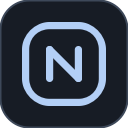
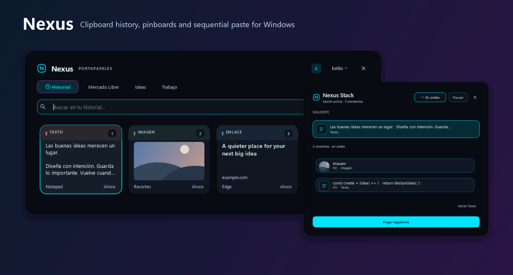

  

<h1 align="center">Nexus</h1>

  <b>Gestor de portapapeles rápido y privado: historial, pinboards y pegado secuencial.</b> 
  Windows hoy, Linux en acceso anticipado y macOS en camino. 
  Pulsa <kbd>Ctrl</kbd>+<kbd>Mayús</kbd>+<kbd>V</kbd>, encuentra lo que copiaste y pégalo donde estabas.

  

<a href="README.md">Read in English</a>

---

## Por qué Nexus

El historial de Windows (<kbd>Win</kbd>+<kbd>V</kbd>) guarda 25 elementos, los olvida al reiniciar y no permite organizar nada. Nexus guarda **todo lo que copias** (texto, enlaces, imágenes y archivos) en una base local, lo muestra en tarjetas y lo pega en la aplicación de donde venías con una sola tecla.

- **Historial instantáneo**: tarjetas para texto, código, enlaces con vista previa, colores, imágenes y archivos. Abre en ~10 ms.
- **Búsqueda al escribir**: sin importar acentos, con índice de texto completo (~1 ms con miles de clips).
- **Pinboards**: colecciones con nombre y color que nunca caducan.
- **Nexus Stack**: copia A, B, C… y pulsa <kbd>Ctrl</kbd>+<kbd>V</kbd> varias veces para pegarlos en orden o al revés. Ideal para formularios.
- **Pensado para el teclado**: <kbd>Ctrl</kbd>+<kbd>1</kbd>…<kbd>9</kbd>, <kbd>Enter</kbd>, <kbd>Mayús</kbd>+<kbd>Enter</kbd> (texto plano), <kbd>F2</kbd> (renombrar), <kbd>Supr</kbd> con <kbd>Ctrl</kbd>+<kbd>Z</kbd> para deshacer. Todos los atajos se pueden cambiar.
- **Cinco temas**, incluido *Liquid Glass* con Acrylic real de Windows 11 que sigue tu modo claro u oscuro.
- **Español e inglés**, según el idioma de tu sistema.

## Plataformas

| | Estado | Cómo obtenerlo |
|---|---|---|
| **Windows 11** | ✅ Versión principal, en español e inglés | [Instalador (.exe)](https://github.com/Manuelcarvajal09/nexus/releases/latest) |
| **Linux** (Wayland: Hyprland, KDE) | 🧪 Acceso anticipado, mismo código que Windows | Desde el código: `python -m nexus_linux.app` (con `NEXUS_UI=shared` usa la nueva interfaz compartida) |
| **macOS** | 🛠️ App nativa original (Swift) en proceso de incorporarse a este repositorio | Próximamente, ver [MACOS.md](MACOS.md) |

Requisitos y opciones de instalación de cada sistema: [docs/PLATFORMS.md](docs/PLATFORMS.md). Plan para la 1.0 y la unificación: [ROADMAP_1.0.md](ROADMAP_1.0.md).

## Instalación en Windows

1. Descarga **`Nexus-Setup-<versión>.exe`** desde la [última versión](https://github.com/Manuelcarvajal09/nexus/releases/latest).
2. Ejecútalo y elige **Instalar solo para mí** (sin permisos de administrador) o **Instalar para todos los usuarios**.
3. Nexus queda en el área de notificación. Ábrelo con <kbd>Ctrl</kbd>+<kbd>Mayús</kbd>+<kbd>V</kbd> y, si quieres, activa *Inicio con Windows* en **Configuración**.

> El instalador aún no está firmado, así que SmartScreen puede mostrar *«Windows protegió su PC»*. Pulsa **Más información › Ejecutar de todas formas**. Cada versión publica el SHA-256 del instalador para que puedas comprobarlo.

Actualizar conserva tu historial, pinboards y configuración. Para desinstalar, ve a *Configuración › Aplicaciones*; te preguntará antes de borrar tus datos.

## Privacidad

Nada sale de tu equipo: todo vive en un archivo SQLite en `%LOCALAPPDATA%\Nexus`.

- Lo que los gestores de contraseñas y navegadores marcan como privado no se guarda nunca. Las copias de 1Password, Bitwarden, KeePass, KeePassXC y LastPass se ignoran por defecto (la lista está en `settings.json`) y puedes pausar la captura desde la bandeja.
- La vista previa de enlaces es opcional y nunca abre enlaces de un solo uso (restablecer contraseña, inicios de sesión, descargas firmadas).
- Lo que borras se sobrescribe en disco y la base se compacta sola.
- Sin telemetría, sin cuenta y sin red, salvo la vista previa opcional.

## Contribuir

Se aceptan issues y pull requests; ver [CONTRIBUTING.md](CONTRIBUTING.md). Si Nexus te ahorra tiempo, una ⭐ ayuda a que otros lo encuentren.

## Licencia

[MIT](LICENSE) © 2026 Manuel Carvajal
