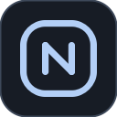
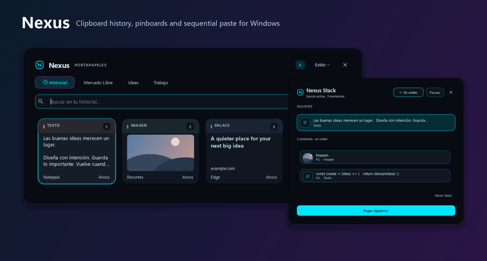
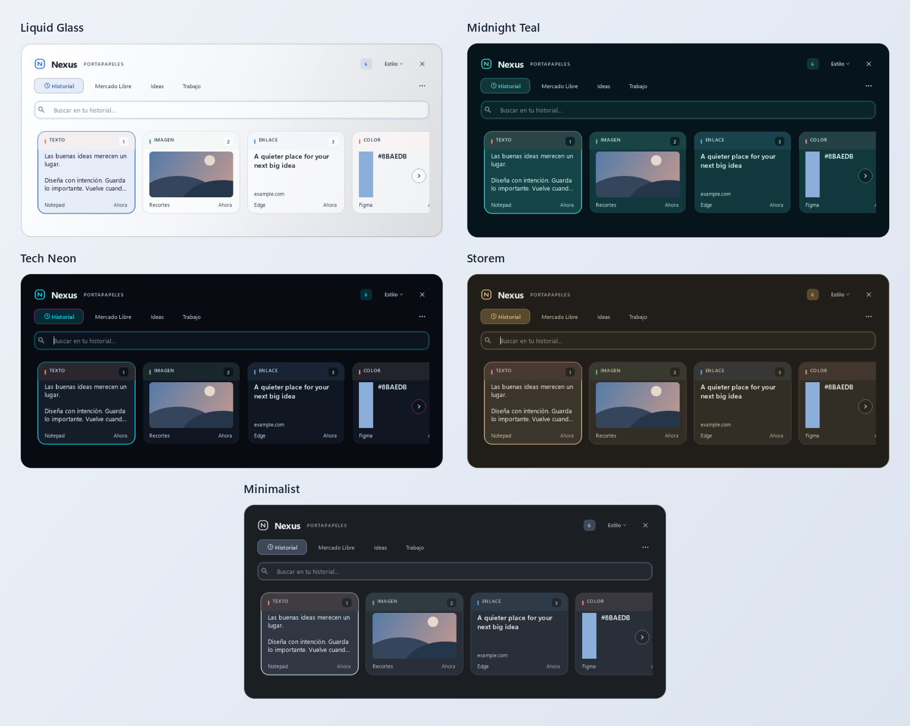
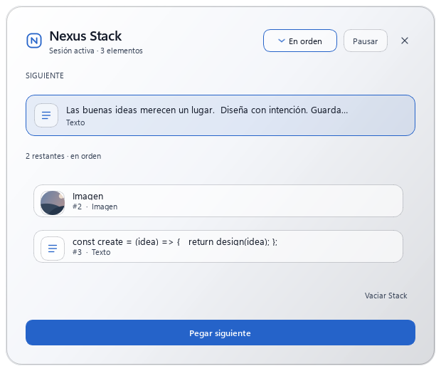
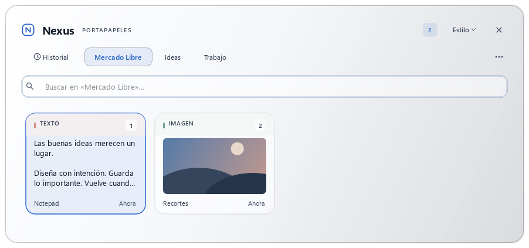
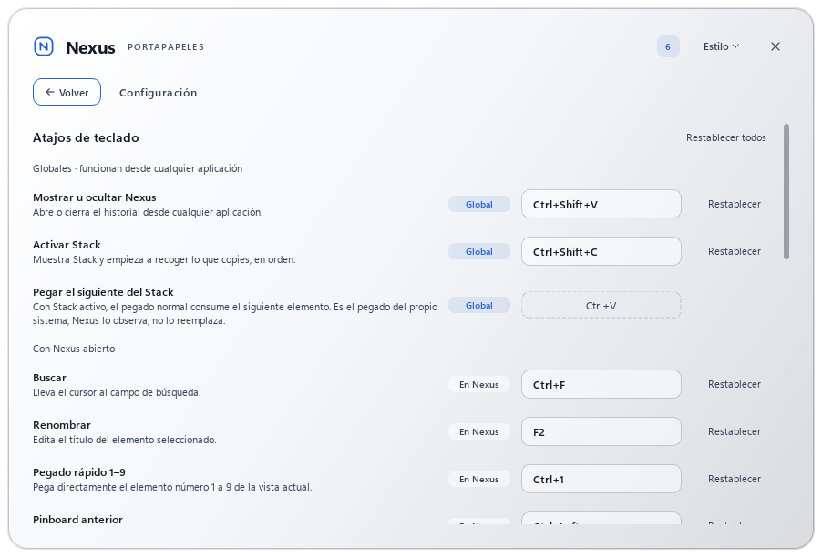

<p align="center">
  
</p>

<h1 align="center">Nexus</h1>

<p align="center">
  <b>A fast, private clipboard manager for Windows: history, pinboards and sequential paste.</b><br>
  Press <kbd>Ctrl</kbd>+<kbd>Shift</kbd>+<kbd>V</kbd>, find anything you copied, paste it where you were.
</p>

<p align="center">
  <a href="LICENSE"></a>
  
  
  
  
  
</p>

<p align="center">
  
</p>

<p align="center"><a href="README.es.md">Leer en español</a></p>

---

## Why Nexus

Windows' built-in clipboard history (<kbd>Win</kbd>+<kbd>V</kbd>) keeps 25 items, forgets them on restart and can't organise anything. Nexus keeps **every text, link, image and file you copy** in a local database, shows them as rich cards, and pastes back into the app you came from, in one keystroke.

- **Instant history.** Cards for text, code, links (with title and image preview), colours, images and files. Opens in ~10 ms.
- **Search as you type.** Accent-insensitive full-text search (SQLite FTS5 trigram index), ~1 ms on thousands of clips.
- **Pinboards.** Keep snippets, replies and assets in named, colour-coded boards that never expire.
- **Nexus Stack: sequential paste.** Copy A, B, C… then press <kbd>Ctrl</kbd>+<kbd>V</kbd> repeatedly to paste them in order, or in reverse. Ideal for filling forms or moving data between apps.
- **Keyboard first.** <kbd>Ctrl</kbd>+<kbd>1</kbd>…<kbd>9</kbd> quick paste, <kbd>Enter</kbd> paste, <kbd>Shift</kbd>+<kbd>Enter</kbd> plain text, <kbd>F2</kbd> rename, <kbd>Del</kbd> delete with <kbd>Ctrl</kbd>+<kbd>Z</kbd> undo. Every shortcut can be changed.
- **Five themes,** including *Liquid Glass*: real Windows 11 Acrylic that follows your light/dark preference.
- **Respects your privacy.** See below.

<p align="center">
  
</p>

## Privacy by design

Nexus never sends your clipboard anywhere. Everything lives in one SQLite file under `%LOCALAPPDATA%\Nexus`.

- **Passwords stay out.** Content that password managers and browsers mark as private (`ExcludeClipboardContentFromMonitorProcessing`, `CanIncludeInClipboardHistory=0`, `CanUploadToCloudClipboard=0`, `Clipboard Viewer Ignore`) is never stored. Copies made in 1Password, Bitwarden, KeePass, KeePassXC and LastPass are ignored by default (the list lives in `settings.json`), and you can pause capture from the tray at any time.
- **Link previews are careful and optional.** Only public addresses are fetched (SSRF-hardened, size and time limits, no redirect downgrade). One-time links (password resets, magic logins, signed downloads, URLs with tokens or credentials) are never opened. You can turn previews off in Settings.
- **Deleted means deleted.** `secure_delete` overwrites removed clips on disk and the database compacts itself.
- **No telemetry, no account, no network** except the optional link previews.

## Install

Requirements: Windows 11 (Windows 10 is untested) and Python 3.11 or newer.

```powershell
python -m pip install "git+https://github.com/Manuelcarvajal09/nexus.git"
nexus-windows
```

Nexus starts in the notification area. Press <kbd>Ctrl</kbd>+<kbd>Shift</kbd>+<kbd>V</kbd> to open it. Turn on *Start with Windows* in **Settings** if you want it always available.

The only runtime dependency is `PySide6-Essentials` (Qt 6 Core/Gui/Widgets).

<details>
<summary>Run from a clone (for development)</summary>

```powershell
git clone https://github.com/Manuelcarvajal09/nexus.git
cd nexus
python -m venv .venv
.venv\Scripts\python -m pip install -e ".[dev]"
.venv\Scripts\python -m nexus_linux.windows_app
.venv\Scripts\python -m pytest
```
</details>

## Shortcuts

| Action | Default |
|---|---|
| Show or hide Nexus | <kbd>Ctrl</kbd>+<kbd>Shift</kbd>+<kbd>V</kbd> |
| Start Nexus Stack | <kbd>Ctrl</kbd>+<kbd>Shift</kbd>+<kbd>C</kbd> |
| Paste the next Stack item | <kbd>Ctrl</kbd>+<kbd>V</kbd> (while the Stack is active) |
| Paste selected card / as plain text | <kbd>Enter</kbd> / <kbd>Shift</kbd>+<kbd>Enter</kbd> |
| Quick paste card 1–9 | <kbd>Ctrl</kbd>+<kbd>1</kbd> … <kbd>Ctrl</kbd>+<kbd>9</kbd> |
| Search | <kbd>Ctrl</kbd>+<kbd>F</kbd> or just start typing |
| Rename card | <kbd>F2</kbd> |
| Delete / undo | <kbd>Del</kbd> / <kbd>Ctrl</kbd>+<kbd>Z</kbd> |
| Previous / next pinboard | <kbd>Ctrl</kbd>+<kbd>←</kbd> / <kbd>Ctrl</kbd>+<kbd>→</kbd> |

## Screenshots

| Nexus Stack | Pinboard | Settings |
|---|---|---|
|  |  |  |

## How it works

- **Capture**: event-driven (`WM_CLIPBOARDUPDATE` through Qt), read-only, with retries for apps that hold the clipboard. Large images are PNG-encoded off the UI thread.
- **Paste**: Nexus remembers the window you came from, restores its focus and sends a marked <kbd>Ctrl</kbd>+<kbd>V</kbd>. When that can't work (for example an app running as administrator) it says so and leaves the content on the clipboard.
- **Stack**: a low-level keyboard hook watches only <kbd>Ctrl</kbd>+<kbd>V</kbd> while the Stack is active, and serialises each paste as a verified transaction.
- **Storage**: SQLite in WAL mode, FTS5 search, lazy image loading, 30-day retention for unpinned clips.

Design notes and audits live in the Markdown files at the root of the repository (in Spanish), for example [UX_AUDIT_2026-11.md](UX_AUDIT_2026-11.md).

## Status

- **Windows**: the main, actively developed build (this branch). The interface is currently in Spanish; English translation is welcome.
- **Linux** (Wayland, Hyprland/KDE): early build on the [`linux/auditoria-2026-11`](https://github.com/Manuelcarvajal09/nexus/tree/linux/auditoria-2026-11) branch.
- Nexus started as a port of a personal macOS app; the original is not published.

## Contributing

Issues and pull requests are welcome. Good first contributions: an English translation of the interface, more card types, and testing on different Windows setups. See [CONTRIBUTING.md](CONTRIBUTING.md).

If Nexus saves you time, a ⭐ helps other people find it.

## License

[MIT](LICENSE) © 2026 Manuel Carvajal
